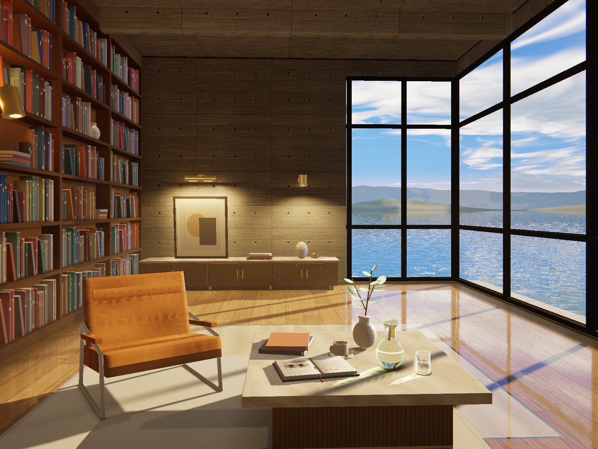

# Vanilla 3D rendering with Gemini 4 Argon

Written by Gemini 4 Argon, the repository includes two self-contained engines that build a sunlit concrete and walnut library from first principles. The first is an offline renderer written in Python and NumPy. The second is a real-time browser engine built with vanilla JavaScript and WebGL2 that reshapes the room as you resize the frame.



## Repository structure

The project is organized into two self-contained folders. Each folder can be inspected or run on its own without external assets.

| Folder | Contents | Entry point |
| :--- | :--- | :--- |
| python | Python and NumPy offline ray tracer | python/sunlit_library.py |
| javascript | Interactive resizable vanilla JavaScript and WebGL2 scene | javascript/index.html |

## Running the live WebGL2 room

The interactive scene runs directly in any modern browser with WebGL2 support and needs no build step, bundler, or external library.

Start a local web server from the root of the repository so the browser can load the page cleanly:

```bash
python3 -m http.server 8000
```

Once the local server is running, open http://localhost:8000/javascript/index.html in your web browser.

Dragging the bottom-right corner or edges of the frame reshapes the room in real time on the graphics card. The walls, window bays, furniture spacing, and sun angle all adapt to fit the new frame proportions.

## Running the Python and NumPy renderer

Install the required NumPy and Pillow packages inside a Python virtual environment before running the offline renderer:

```bash
pip install -r python/requirements.txt
```

Render the standard 1600 by 1200 architectural photograph, which saves to renders/sunlit_library_1600x1200.png by default when no custom path is given:

```bash
python3 python/sunlit_library.py
```

Pass the widescreen flag to render a 16:9 panoramic edition at 1920 by 1080 pixels in the same output folder:

```bash
python3 python/sunlit_library.py --16x9
```

You can also render at any custom pixel resolution and output path using environment variables and a filename argument:

```bash
PAINT_WIDTH=800 PAINT_HEIGHT=600 python3 python/sunlit_library.py output/preview.png
```

## How the room is laid out

The room sits inside a three-dimensional coordinate system measured in meters. In the table below, X measures width from left to right, Y measures height from floor to ceiling, and Z measures depth away from the camera.

| Element | World bounds | Material and geometry |
| :--- | :--- | :--- |
| Concrete shell | X -3.10 to +3.20 m, Y 0.00 to 4.25 m, Z up to 7.60 m | Board-formed concrete rear wall and ceiling beams with vertical timber formwork grain, pour joints, and recessed tie-rod cones |
| Corner window | Right wall at X +3.20 m and rear bay X +1.08 to +3.20 m | Low-iron glass in dark steel frames opening onto a travertine pool terrace, rippled sea bay, coastal headlands, and layered clouds |
| Walnut bookcase | Left wall X -3.10 to -2.72 m, five bays by seven tiers | American walnut shelves with 4,190 spatial slots holding over 380 books, seven horizontal stacks, stone bookends, and ceramic vessels |
| Rear credenza | Rear wall X -1.85 to +0.85 m, Z 6.96 to 7.60 m | Four-door walnut cupboard with honed travertine top and bronze plinth beneath a framed architectural artwork and two brass lamps |
| Floor assembly | Y 0.00 m across full room footprint | Wide-plank European white oak floorboards with dark bevel seams, bordered by honed travertine stone and a brushed brass inlay strip |
| Lounge seating | Foreground and midground floor plane | Honed travertine coffee table on a fluted walnut pedestal, tufted cognac leather lounge chair, and cream woven wool rug |
| Tabletop objects | Coffee table surface at Y 0.39 m | Open art folio with silk ribbon, two stacked books, fluted travertine eucalyptus vase, espresso cup on saucer, carafe, and crystal tumbler |

## How light and materials are computed

Both the Python renderer and the WebGL2 browser engine build the image through seven physical steps. Each step solves one part of how light travels through a real room:

- Ray tracing follows one viewing ray per pixel from the camera into the room until it hits a geometric shape such as a box, cylinder, sphere, or curved page.
- Surface normals are tiny 3D tilt vectors that perturb each hit point to carve wood pores, travertine pits, wool loops, and timber grain without storing polygon meshes.
- Ambient occlusion darkens tight crevices where bookshelves, chair runners, and the table base block surrounding daylight from reaching the floor.
- Radiosity simulates how warm light from the sun and brass wall lamps bounces off oiled oak floorboards and walnut shelves to fill shadowed corners.
- Anisotropic reflections trace secondary rays from the floor and stretch bright window glare along the length of each oak board, matching real wood fibers.
- Snell refraction bends light twice as it enters and leaves the curved glass carafe and water tumbler, focusing bright arcs called caustics onto the stone tabletop.
- Volumetric scattering and film tone mapping step through the air to catch glowing dust motes in the sunbeams, then compress bright sky and dim shadow into balanced film colors.

## How the room adapts when you resize the frame

In the browser version, dragging the window handles does not crop or stretch a static picture. Instead, the engine rebuilds the room layout and shifts the sun to suit the new frame shape.

| Viewport axis | Architectural response | Lighting response |
| :--- | :--- | :--- |
| Horizontal width | Widens or narrows the rear concrete wall, walnut cupboard, and window bays while keeping a clear walkway between the chair and table | Sweeps the sun angle horizontally across the sky and shifts coastal headland parallax |
| Vertical height | Raises the ceiling, adds two upper bookcase tiers in tall portrait views, and adjusts camera shift | Lowers the sun toward warm evening light while brightening the interior brass lamps |

## Disclaimer

This is not an officially supported Google product. This project is not eligible for the [Google Open Source Software Vulnerability Rewards Program](https://bughunters.google.com/open-source-security).
